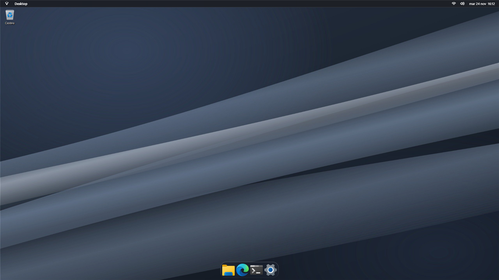
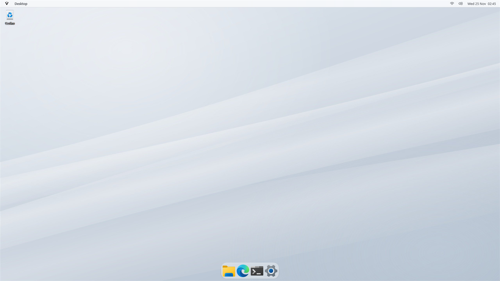
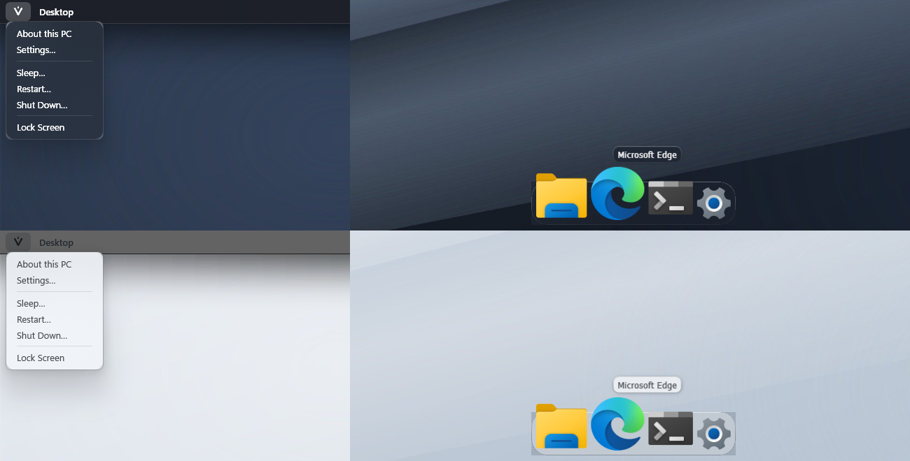
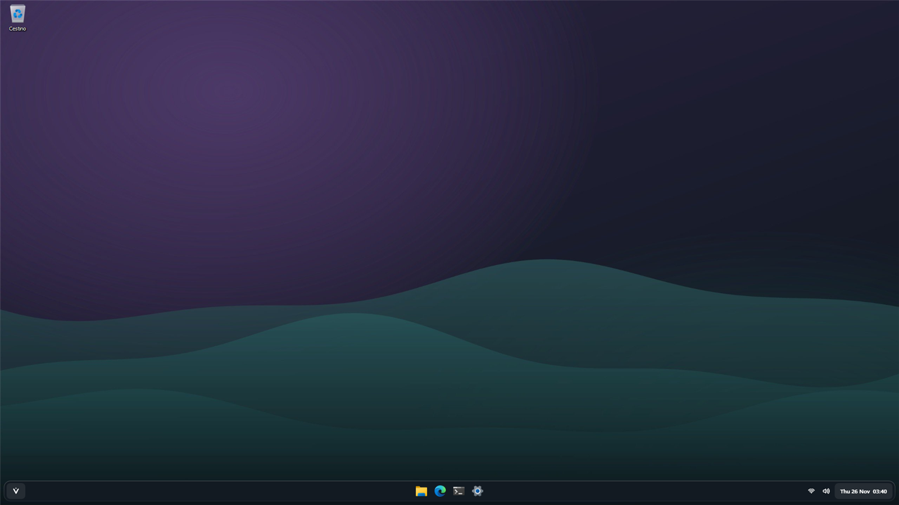
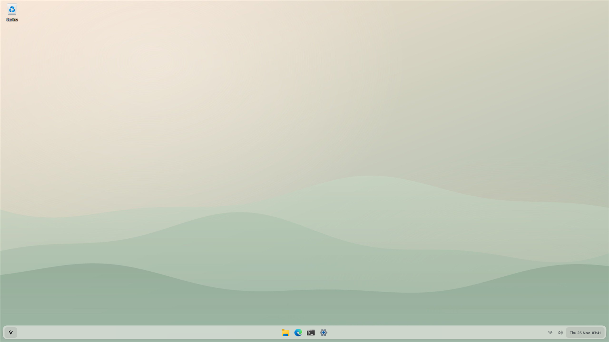
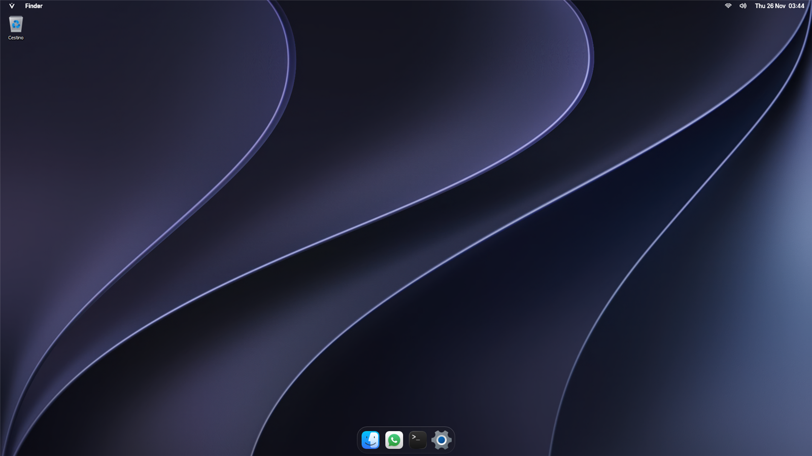
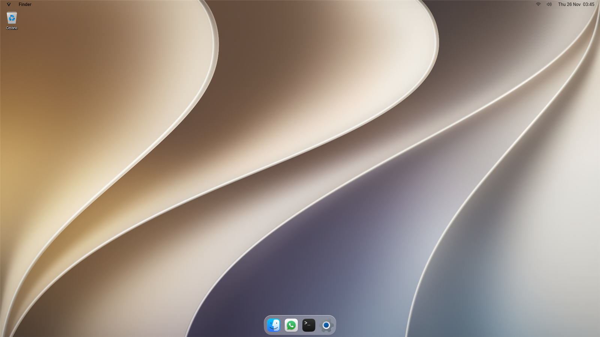
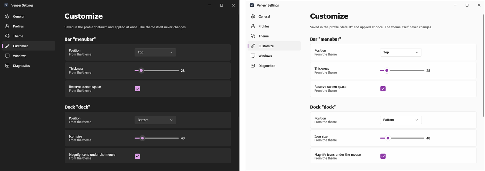

<div align="center">

# Veneer

**A themeable desktop shell for Windows 11: themes decide which bars and docks you get, where they sit and how they
look.**

[](https://github.com/Mynamesdsuper/veneer/actions/workflows/ci.yml)
[](LICENSE)


[Screenshots](#screenshots) · [Status](#project-status) · [Why Veneer](#why-veneer) · [Is it safe?](#is-it-safe) ·
[Testing](#testing-and-stability) · [Build](#build) · [Themes](#themes) · [Roadmap](docs/roadmap.md) ·
[Decisions](docs/decisions.md) · [License](#license)

</div>

Veneer replaces the Windows taskbar with its own bars and dock, and lets *themes* decide everything about them:
which pieces exist, which screen edge they sit on, which modules they show and how they look. Your own tweaks sit on
top of the theme, and the Windows taskbar always comes back when Veneer quits.

Written in C# and WPF on .NET 10, with a thin Win32 layer. No Electron, no web views, no code inside other apps.



## Screenshots

### Aqua, the default theme

A glass menu bar on top and a magnifying dock at the bottom, with original artwork, in dark and light.

| | |
|---|---|
|  **Light** variant: it follows the Windows mode |  **Logo menu** and the **dock** magnifying under the cursor, with its label |

### Strip

The same engine with a completely different layout: one floating, taskbar-like bar and no dock.

| | |
|---|---|
|  **Dark** |  **Light** |

### A personal theme

What a local theme can look like: a macOS-like setup built with `tools/svg-icons`. It is **not part of Veneer** and
is not distributed here: its wallpapers and its icons (MacTahoe, GPL-3.0) belong to their owners.

| | |
|---|---|
|  **Dark** |  **Light** |

### Settings

The settings window in the Windows 11 style, with Veneer's own frame, in English and Italian. Every value shows
whether it comes from the theme or from you, with "reset to theme value".



## Project status

**Early preview. Not ready for daily use yet.** The theme engine works and is tested. The app draws blurred bars
from a theme with all their modules and a dock with magnification, hides the taskbar and always gives it back.
Themes also set the wallpaper, accent color and light/dark mode, with a full restore. Profiles switch theme,
overrides and Windows settings together, and a settings window changes the main values, installs themes and copies
a diagnostics report. Every feature has its checkbox in [docs/roadmap.md](docs/roadmap.md).

| What | Status |
|---|---|
| Repository, CI (build + tests on `windows-latest`) | ✅ Done |
| Code review of the theme engine, bars and dock (2026-11-24) | ✅ Done: findings fixed and tested ([details](docs/decisions.md#2026-11-24-code-review-of-phases-24)) |
| Real blur behind bars | ✅ In the app: DWM acrylic on a non-activating window ([details](docs/decisions.md#blurred-overlay-windows-spikesoverlayblur)). Rounded dock glass at any radius |
| Bars on any edge, several at once, with reserved screen space | ✅ In the app, built from the theme and rebuilt on hot reload |
| Hide the taskbar, always bring it back | ✅ In the app: normal exit, unhandled exception, crash or kill (a watchdog outside Veneer's process tree, so "End process tree" is covered too), next start, Explorer restart, and a RunOnce entry for power loss. One Veneer at a time. Logoff is wired but untested |
| Theme engine: parse, validate, tokens, light/dark variants | ✅ Done, unit-tested |
| Your overrides on top of a theme, with value origins and orphans | ✅ Done, unit-tested |
| Safe theme files and `.zip` install (path, link, type and size checks) | ✅ Done, unit-tested |
| Hot reload, fallback to the previous theme on errors | ✅ Done, unit-tested |
| Bar modules: logo menu, active app, clock, volume, network, battery, spacer | ✅ Done. Status icons use Windows glyphs unless the theme gives its own images |
| Dock: pinned and running apps, live updates, system or theme icons, click to open or switch | ✅ Done |
| Dock: hover magnification, context menu, drag to reorder, separators, auto-hide, saved pinned apps | ✅ Done (drag still to be tried by hand) |
| Wallpaper, accent color, light/dark from the theme, with restore | ✅ Done: each one from the theme or the system, snapshot before the first change, byte-for-byte restore tested |
| A polished look: highlights, themed menus, dock labels, launch bounce, stretching dock | ✅ Done (Phase 6a) |
| A real default theme, **Aqua** (macOS-like, original artwork, light and dark) | ✅ Done, used when no theme is chosen |
| Profiles, Veneer menu (bar and notification area), start with Windows | ✅ Done (Phase 7a) |
| Settings window: profiles, theme install, your values with "reset to theme value", Windows choices, diagnostics; English and Italian | ✅ Done (Phase 7b) |
| First-run import of the taskbar's pinned apps (Store apps included, no duplicates) | ✅ Done (Phase 7c) |
| Settings window polish and Veneer's own window frame (title bar, caption buttons, snap layouts kept) | ✅ Done (Phase 7d; snap flyout and drag still to be tried by hand) |
| Two bundled themes with very different layouts: Aqua (menu bar + dock) and Strip (one floating taskbar-like bar) | ✅ Done (Phase 8a) |
| Icon conversion tool (SVG → PNG with an exe map) and visual fidelity pass | ✅ Done (Phase 8b) |
| More dock items: Downloads, Recycle Bin (empty/full, drop files on it), one dot per window and a window list | ✅ Done (Phase 8c) |
| Reduced effects, stall watch, stress test, measured performance | ⏳ Planned (Phase 9) |
| First release | ⏳ Planned (Phase 9) |
| Multi-monitor, display scaling above 100%, ARM64 | ❔ Not verified yet |

✅ done · ⚠️ partly done · 🧪 proven in a spike, not in the app yet · ⏳ planned · ❔ not verified

## Why Veneer

Most Windows customization tools either restyle one piece (a dock, a bar) or ship a single fixed look.
Veneer is built around a different idea:

- **Themes control layout, not just colors.** A theme can be a top menu bar plus a bottom dock, one
  slim bar on the left, or anything in between, all without touching code.
- **Your tweaks live on top of the theme.** Change the icon size, pin apps, recolor a bar: your
  changes are stored separately, so switching or updating a theme never wipes them.
- **Profiles.** Save a whole setup (theme, variant, your tweaks, which Windows settings to apply) and
  switch between setups in one click, for example *Work* and *Gaming*.
- **Themes are data, never code.** A theme is a `theme.json` plus images and fonts. Installing a theme
  from a stranger cannot run anything on your PC.
- **Always reversible.** The Windows taskbar comes back when Veneer exits, even after a crash. Every
  Windows setting a theme changes (wallpaper, accent color, light/dark mode) can be restored to what you had.

## Is it safe?

A fair question for anything that hides your taskbar. You do not have to trust the author: the code is MIT and
every claim below can be checked in it.

- **No network at all.** Veneer contacts no server: no telemetry, no accounts, no update check. (An opt-in update
  check is planned after the first release; it will verify the file's hash and never update silently.)
- **No administrator rights.** Veneer runs as your user. No services, no drivers, no scheduled tasks.
- **Nothing inside other apps.** Veneer never loads code into other processes and never reads other apps' menus.
  It only lists their windows and reads the apps' names, icons and window titles, to show them in the dock and the bar.
- **Your files stay where they are.** The dock's Downloads item reads the names of the newest files only when you
  click it. The Recycle Bin item empties the bin only through Windows' own confirmation, and files dropped on it go
  to the bin, never deleted for good.
- **Themes cannot run code.** A theme is JSON plus images and fonts. Paths must stay inside the theme folder (no
  `..`, absolute paths or links), only known file types are read, and `.zip` installs are checked for size and
  zip-slip.
- **What it changes, and how it gives it back:**
  - The taskbar: auto-hide plus hidden, restored on exit, crash, kill (by a watchdog process), Explorer restart,
    next start and power loss. **Ctrl+Alt+Shift+F12** ends Veneer and restores the taskbar if it ever hangs.
  - Wallpaper, accent color and light/dark mode, only if the theme asks and you allow each one: a snapshot is saved
    before the first change, and "Restore original Windows settings" puts back exactly what you had.
  - Start with Windows: one entry under `HKCU\...\Run`, off by default.
  - Only your user's registry hive (`HKCU`) is written. Veneer's own files live in `%APPDATA%\Veneer`.

## Testing and stability

- **348 unit tests** for the theme engine, overrides, profiles, layout, dock logic and file safety, run by CI on
  every push.
- **Every exit path of the taskbar** was tested on a real PC: normal exit, unhandled exception, `FailFast`,
  `taskkill /f`, "End process tree", Explorer restart. The results are in [docs/decisions.md](docs/decisions.md).
- **Windows settings restore** is checked value by value against a record taken before each real run (0 differences
  expected).
- **A self-test mode** drives the real app (menus, dock hover, profile and theme switches, settings pages,
  screenshots) without simulated input, so visual checks can be repeated.
- **A code review at the end of every phase**, with the fixes listed in [docs/decisions.md](docs/decisions.md).
- **Known gaps:** multi-monitor, display scaling above 100%, ARM64 and logoff with the taskbar hidden are not
  verified yet. Drag to reorder and snap layouts still need a test by hand.

## Roadmap

| Phase | Scope | Status |
|---|---|---|
| 1 | Repository skeleton, CI | ✅ |
| 0 | Technical spikes: blur, app bars, taskbar safety, accent API | ✅ |
| 2 | Theme engine and personalization layers | ✅ |
| 3 | Layout engine, bars and their modules | ✅ |
| 4 | Dock | ✅ |
| 5 | Windows settings from themes (wallpaper, accent, light/dark) with restore | ✅ |
| 6 | Look and feel: what the engine can draw, and a real default theme | ✅ |
| 7 | Profiles, settings window, tray, theme install, start with Windows | ✅ |
| 8 | Bundled themes | ✅ |
| 9 | Polish, reduced effects, stability checks, documentation, first release | ⏳ |

**Later:** a frosted "glass material" option, desktop widgets (calendar, weather, battery, photos), widget tiles for the bars, a launcher,
live window previews, a live theme editor, an in-app theme gallery, automatic profile switching, accent color from
the wallpaper, full multi-monitor support. Every feature, phase by phase, with its checkbox:
[docs/roadmap.md](docs/roadmap.md).

## Requirements

- Windows 11 (22H2 or later). Windows 10 is not supported.
- To build: [.NET 10 SDK](https://dotnet.microsoft.com/download/dotnet/10.0).

## Build

```powershell
git clone https://github.com/Mynamesdsuper/veneer.git
cd veneer
dotnet build
dotnet test
dotnet run --project src/Veneer.App                          # the active profile (Aqua at first)
dotnet run --project src/Veneer.App -- --theme <theme folder>  # one theme, profiles off
```

While Veneer runs, **Ctrl+Alt+Shift+Q** quits and gives the taskbar back. **Ctrl+Alt+Shift+T** restores the
taskbar without quitting, and **Ctrl+Alt+Shift+P** switches to the next profile. The logo menu's **Veneer ›**
item (or Veneer's icon in the notification area) switches profile and theme, opens **Veneer Settings…**, turns on
starting with Windows, and quits. If Veneer ever hangs, **Ctrl+Alt+Shift+F12** ends it and restores the taskbar. By hand:
`Veneer.App --restore-taskbar`, and `Veneer.App --restore-windows-settings` for the wallpaper, accent color and
light/dark mode.

## Repository layout

```
src/
  Veneer.Core/      Theme model, parser and validator, personalization merge, profiles, layout logic.
                    No WPF or Win32 dependencies, fully unit-tested.
  Veneer.Interop/   Thin Win32 layer: window tracking, app bars, taskbar, wallpaper, accent, light/dark.
  Veneer.App/       WPF application: bars, dock, modules, settings window, tray icon.
tests/
  Veneer.Core.Tests/
themes/             Themes shipped with Veneer (original assets only).
tools/              Developer tools (icon conversion, theme art). Never used by the theme loader.
docs/
  theme-format.md   How to write a theme.
  roadmap.md        Full plan with a checklist of every feature.
  decisions.md      Technical decisions and spike results.
spikes/             Phase 0 throwaway code (not in the solution, not built by CI).
```

## Themes

A theme is a folder (or `.zip`) with a `theme.json` and an `assets/` folder. See
[docs/theme-format.md](docs/theme-format.md). The format can still change until the first release.

Community themes must respect the licenses of the assets they use. Veneer only ships original assets
or assets with a compatible, declared license.

## Contributing

The project is not ready for contributions yet. Issues with ideas and feedback are welcome.

## License

[MIT](LICENSE): use, change and share the code freely, keeping the copyright notice.

The bundled themes use original assets only. Assets in your own themes (icons, fonts, wallpapers) keep their own
licenses.

Veneer is an independent project. It is not affiliated with, endorsed by or sponsored by Microsoft or
Apple. Windows is a trademark of Microsoft Corporation; macOS is a trademark of Apple Inc.
